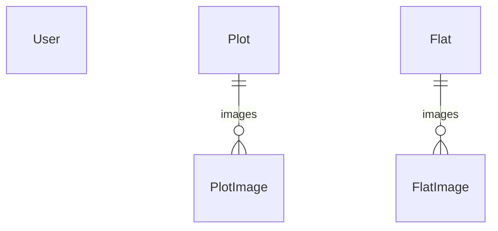

# Database

PostgreSQL through Prisma ORM 7. The schema file is the source of truth.

**Schema:** [`prisma/schema.prisma`](../prisma/schema.prisma)  
**CLI config:** [`prisma.config.ts`](../prisma.config.ts)  
**App client:** [`src/lib/prisma.ts`](../src/lib/prisma.ts)

See also: [Listings](./listings.md), [Auth](./auth.md), [Errors](./errors.md)

---

## Goals

- One schema for admin accounts, plots, and flats.
- Generated client code stays out of git.
- Local migration commands and production migration commands stay different.

---

## How it is wired

The Prisma CLI is plain Node. It does not load Next.js env files. [`prisma.config.ts`](../prisma.config.ts) reads `DATABASE_URL` from `.env` through `dotenv`.

The running app imports the client from [`src/lib/prisma.ts`](../src/lib/prisma.ts). That file uses `@prisma/adapter-pg` and the validated `DATABASE_URL` from `@/config/env`.

`prisma generate` writes the client to `src/generated/prisma`. That folder is gitignored. Create it with `pnpm db:generate`, or with `pnpm build`, which runs generate before the Next.js build. Do not edit the generated files.

| Command           | When                                                                                                                    |
| ----------------- | ----------------------------------------------------------------------------------------------------------------------- |
| `pnpm db:migrate` | On your machine. `prisma migrate dev` applies pending migrations and can create a new folder under `prisma/migrations`. |
| `pnpm db:deploy`  | On a server. `prisma migrate deploy` applies migration folders that already exist. It does not create one.              |
| `pnpm db:studio`  | Opens Prisma Studio.                                                                                                    |
| `pnpm db:status`  | Shows whether the database matches the migration history.                                                               |

CI does not run migrations. See [Continuous integration](../CONTRIBUTING.md#5-continuous-integration).

Prisma errors thrown from a route handler are mapped in [Errors](./errors.md).

---

## Relationships

`User` has no relations. A plot owns its images. A flat owns its images. Deleting a plot or flat deletes its image rows (`onDelete: Cascade`).

There is no customer account, no leads table, and no site-settings table. Those gaps are listed in [Auth](./auth.md).

---

## User

Table `users`. Admin accounts only.

| Field      | Column      | Notes                                   |
| ---------- | ----------- | --------------------------------------- |
| `id`       | `id`        | UUID                                    |
| `email`    | `email`     | Unique                                  |
| `password` | `password`  | `scrypt` hash, never the typed password |
| `role`     | `role`      | `ADMIN` or `SUPER_ADMIN`                |
| `isActive` | `is_active` | Defaults to true                        |

---

## Plot

Table `plots`. Images are `plot_images`, ordered by `sort_order`, indexed by `plot_id`.

| Field             | Column             | Notes                                                   |
| ----------------- | ------------------ | ------------------------------------------------------- |
| `name`            | `name`             | Unique, max 120 characters                              |
| `slug`            | `slug`             | Unique, max 160 characters                              |
| `status`          | `status`           | `AVAILABLE`, `RESERVED`, or `SOLD`. Default `AVAILABLE` |
| `published`       | `published`        | Default false. Indexed                                  |
| `facilities`      | `facilities`       | List of strings                                         |
| `shotangshoPrice` | `shotangsho_price` | String, max 120 characters                              |
| `landAreaSize`    | `land_area_size`   | String, max 120 characters                              |
| `description`     | `description`      | String, max 20000 characters                            |

`shotangshoPrice` and `landAreaSize` are strings. Do not sort or sum them in SQL and expect numbers.

---

## Flat

Table `flats`. Images are `flat_images`, with the same cascade and sort rules as plots.

A flat uses the same `published` flag, the same status enum, and the same unique `name` and `slug` rules. Extra fields:

| Field                 | Column                  | Notes                                        |
| --------------------- | ----------------------- | -------------------------------------------- |
| `propertyType`        | `property_type`         | `RESIDENTIAL`, `COMMERCIAL`, or `BOTH`       |
| `constructionStatus`  | `construction_status`   | `READY`, `UNDER_CONSTRUCTION`, or `UPCOMING` |
| `buildingTotalFloors` | `building_total_floors` | Integer                                      |
| `pricePerSqft`        | `price_per_sqft`        | String, max 120 characters                   |
| `handoverDate`        | `handover_date`         | String, max 120 characters                   |

`pricePerSqft` is a string, same as the plot price fields.

---

## Related files

- [`prisma/schema.prisma`](../prisma/schema.prisma)
- [`prisma.config.ts`](../prisma.config.ts)
- [`src/lib/prisma.ts`](../src/lib/prisma.ts)
- [`prisma/migrations/`](../prisma/migrations/)
